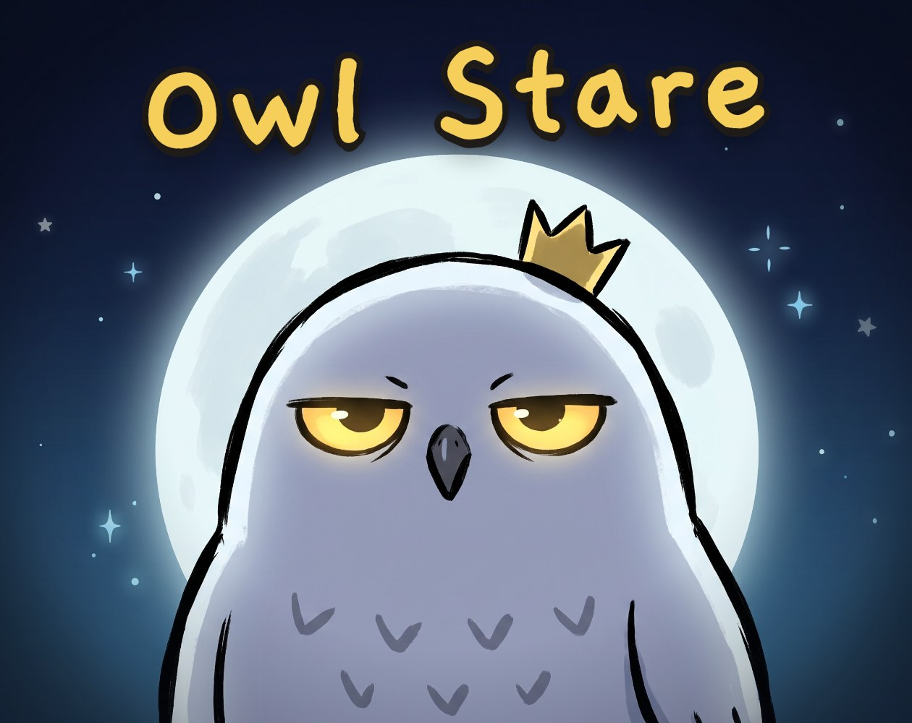
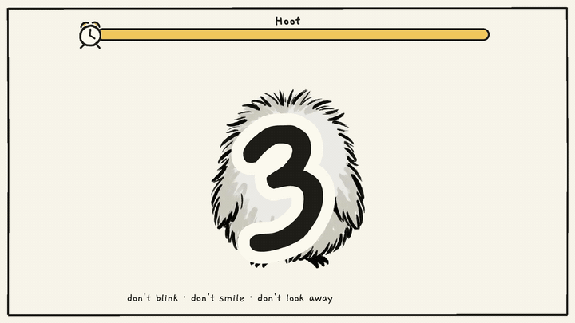
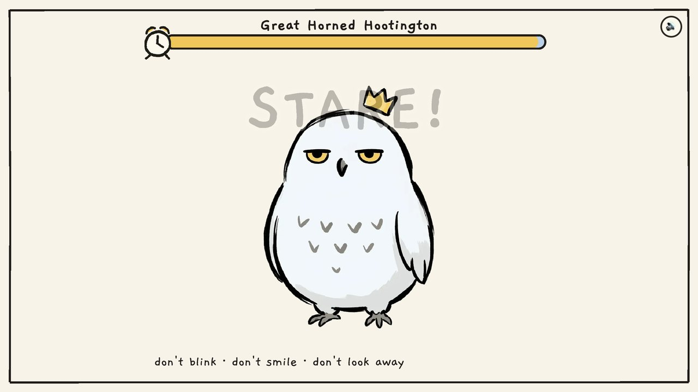
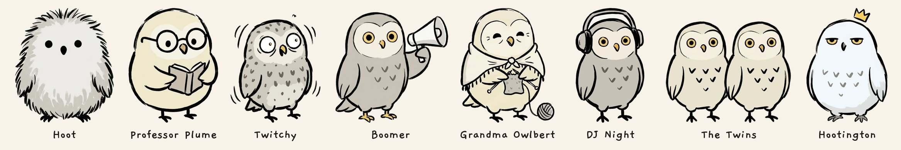
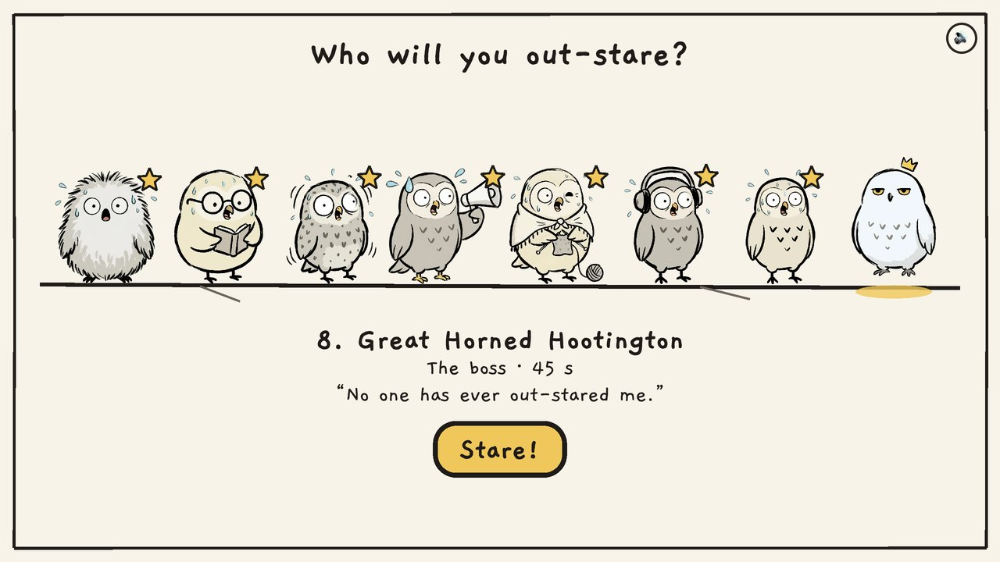
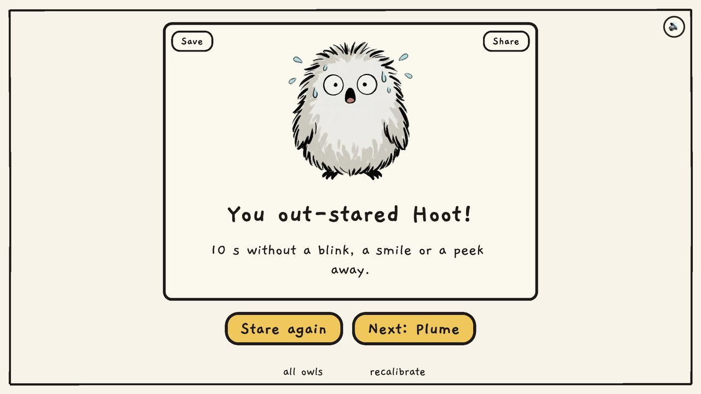
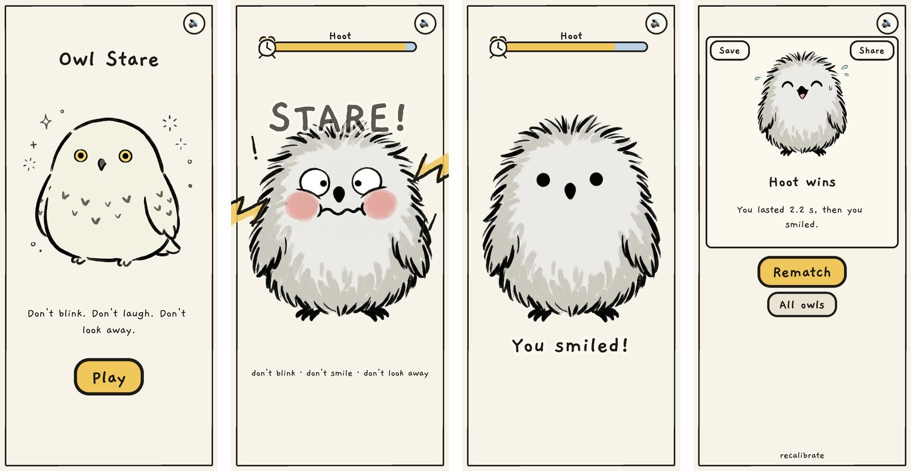
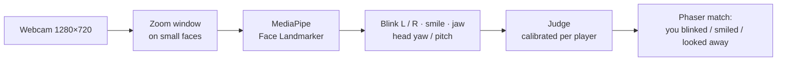

# 🦉 Owl Stare

A **webcam staring contest against owls who cheat**. Look into your camera, wait for *3, 2, 1, STARE!* and hold it. Blink, smile or look away and you lose. Eight hand-drawn snowy owls try everything to break you: silly faces, feathers, flies, bad jokes, a megaphone, a dance. Your face is tracked right in the browser, and the camera video never leaves your device.



**[▶ Play Owl Stare on itch.io](https://gianneangely.itch.io/owl-stare)**: free, in your browser, on desktop or phone.



## How to play



1. Allow the camera. A five-second calibration learns your normal face, your blink and your smile.
2. Pick an owl on the ladder and press **Stare!**
3. After *3, 2, 1, STARE!* keep looking at the owl until the clock runs out.

You lose the moment you:

- **blink**, with both eyes or just one
- **smile or laugh**
- **look away** or leave the camera

Beat an owl to unlock the next one. Progress is saved in your browser.

## The owls



| # | Owl | Their dirty tricks | Stare for |
| --- | --- | --- | --- |
| 1 | **Hoot**, the beginner | silly faces, a flurry of feathers | 10 s |
| 2 | **Professor Plume**, pompous | reads you terrible jokes | 15 s |
| 3 | **Twitchy**, can't sit still | a fly, feathers, fake pop-ups | 20 s |
| 4 | **Boomer**, loud | HOOT! into a megaphone, a squeaky duck | 20 s |
| 5 | **Grandma Owlbert**, sweet then sneaky | knits quietly… then a surprise face | 25 s |
| 6 | **DJ Night**, party owl | drops a beat and dances | 25 s |
| 7 | **The Twins** | two owls, two sets of tricks at once | 30 s |
| 8 | **Great Horned Hootington**, the boss | every trick, without waiting for the last one to finish | 45 s |



## Share the result, not your face



After each match you get a result card to **save** or **share**: the owl, how long you lasted and why you lost. It is drawn from the game's own art, never from the camera, so your face can't end up in it.



## Privacy

- Face tracking runs **entirely in your browser** with MediaPipe. No frame, image or measurement is sent anywhere, and nothing is recorded.
- The game works offline once loaded: the model, wasm and fonts are all bundled, with no CDN requests.
- You can hide your own camera preview at any time with the 👁 button.

## How it works



- **Signals** come from the Face Landmarker's blendshapes (`eyeBlinkLeft/Right`, `mouthSmileLeft/Right`, `jawOpen`) and its face transform matrix (head yaw and pitch).
- **Calibration** finds where each player's eyes rest and close, separately for each eye, so the blink line suits every face and every distance from the camera.
- **Rules** (`src/face/judge.js`, pure and unit-tested): a blink must hold for two frames, so one noisy frame never ends a match; either eye shut loses, judged from the face mesh (each lid gap against its calibrated resting gap), because the blink blendshapes move both eyes together during a wink; a smile pushes the blink line up so a grin is judged as a smile; looking away must last half a second.
- **Far away** players: once a face is found, the tracker looks at a steady zoomed window around it, so a face 1–2 m from the camera is still big enough for the model. Small faces get more room for head angle, a resting pose that follows a player who steps back, and longer to come back after a dropout before it counts as looking away.
- **Tests** replay real footage through the rules: 30 s of a public-domain talking-head video and two winking clips, near and shrunk far away, checked against hand-labelled blinks and winks.

## Run locally

No build step. ES modules and wasm need a web server (not `file://`), and the camera needs `localhost` or HTTPS:

```bash
git clone https://github.com/GianneAngely/owl-stare.git
cd owl-stare
npm run serve      # http://localhost:8080/
npm test           # judge, calibration and the real-footage replays
```

Handy pages and switches:

- `index.html?fake` — play without a camera: a scripted fake face (also silences the sound)
- `index.html?mute` — no sound
- `index.html?debug` — live face numbers in the corner (each eye, smile, head angle), handy for a screenshot when a blink is missed
- `spike.html` — live detection meters and calibration
- `tools/build-zip.sh` — the itch.io web build (`itch/owl-stare-web.zip`, under 10 MB)
- `tools/check.mjs` — headless Chrome screenshots and scripted runs, with Chrome's fake camera

## What's inside

- **src/** — the game: scenes, the face tracker and judge, owls and their tricks, the result card, synthesized sound
- **assets/owls/** — one drawing per owl and pose (rest, blink, laugh, shock, tongue, cross-eyed, shout)
- **lib/**, **models/** — Phaser and MediaPipe, vendored (see `lib/README.md` for their licenses)
- **test/** — unit tests and the scripted headless runs
- **tools/** — the local server, headless checks, the itch build and the art pipeline (cut, align, cover)
- **concept/** — Angel's concept art the owls are drawn from
- **itch/** — the itch.io page text, cover and screenshots
- **GDD.md**, **PLAN.md** — the game design document and build notes

## Credits

- Design, concept art and direction: **Angel (Gianne Angely)**
- Owl drawings: made in Google Flow from Angel's own concept art, then cut and aligned in `tools/`
- Sound: all synthesized in code with Web Audio, no audio files
- [Phaser](https://phaser.io) (MIT), [MediaPipe](https://ai.google.dev/edge/mediapipe) (Apache 2.0), [Gaegu](https://fonts.google.com/specimen/Gaegu) font (SIL OFL)

## Built with

Phaser 3.90 · MediaPipe Face Landmarker · Web Audio · Node.js test runner

Plain JavaScript modules, no build step, everything on-device.
